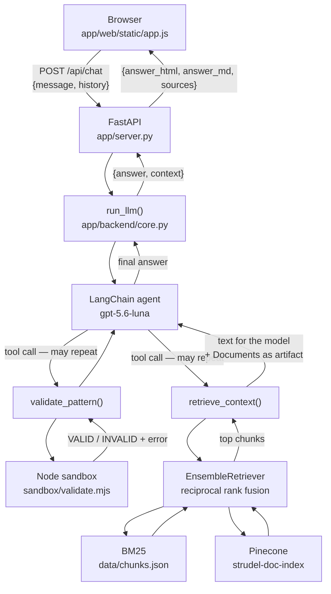
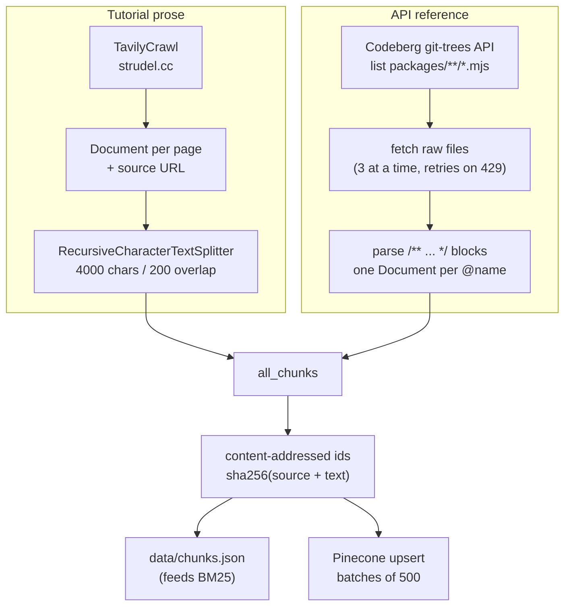

# Architecture

How StrudelAssistant is put together, why the pieces are shaped the way they are,
and which parts you have to keep in step with each other.

For "how do I change X", see [extending.md](extending.md).

## The two pipelines

The project is really two programs that only meet through stored data:

| | Ingestion | Serving |
| --- | --- | --- |
| Entry point | `app/ingestion.py` | `app/server.py` |
| When | Run by hand, rarely | Every request |
| Cost | Paid and slow (crawl + embed thousands of chunks) | One model call per question |
| Writes | `data/chunks.json`, Pinecone index | nothing |
| Reads | the web | `data/chunks.json`, Pinecone index |

Ingestion builds the corpus. Serving answers questions from it. Nothing in the
serving path ever writes to the corpus, so you can restart, edit and redeploy
the app freely without touching the index.

Serving has two ways in, `POST /api/chat` and `POST /api/hum`, and both end at
the same `run_llm` agent. The chat path comes first below. The hum path has its
own section, and [humming.md](humming.md) covers it in full.

## Serving: what happens when you ask a question



Step by step:

1. **The browser posts the question plus prior turns.** `history` deliberately
   excludes the current question — the server appends it last. Without history
   the agent cannot resolve follow-ups like *"now add reverb to that"*.
2. **`server.py` hands off to `run_llm`.** The endpoint is a plain `def`, not
   `async def`, so FastAPI runs it in a worker thread — `run_llm` blocks on the
   network and would otherwise stall the event loop for every other request.
3. **The agent decides whether to search.** The system prompt instructs it to
   always call `retrieve_context` before answering anything about Strudel, and
   to search again with different wording if the first pass is unhelpful. So one
   question can produce several retrievals.
4. **Retrieval is hybrid** (see below).
5. **The agent loops** — tool call, observation, maybe another tool call — until
   it produces a plain text answer. That is the last message in the transcript.
6. **`run_llm` walks the whole transcript** collecting retrieved documents from
   every `ToolMessage`, and returns `{answer, context}`.
7. **`server.py` renders the markdown to HTML** and de-duplicates the sources.
8. **The browser decorates the HTML**: every fenced code block becomes a
   playable pattern module.

### The agent loop is ReAct, and the sandbox is what it reacts to

The agent has two tools and is told to use them in a loop rather than once
each: search the documentation, write a pattern, run it, read the error,
search for the function it got wrong, fix it, run it again.

That only works because the second tool returns ground truth.
`validate_pattern` evaluates the candidate in Node with the real Strudel
engine and reports either what the pattern does or the exact error. An
undefined function, a mini-notation parse error, a pattern that is silent, a
General MIDI soundfont this app never loads: all of them come back as text the
agent can act on.

The alternative was another rule in the system prompt, and that approach was
visibly running out of road. Every failure mode we found had to be anticipated
and written down, and the model still produced new ones. A tool that runs the
code does not need to anticipate anything.

Two properties of the sandbox are load-bearing and easy to break:

- **It never plays audio.** Patterns are *queried*, which is Strudel's own way
  of asking what events fall between two cycles. That is pure computation, so
  there is no audio device, no scheduler and no real time involved.
- **It runs under Node's permission model.** Measured against this sandbox:
  without `--permission`, evaluated code wrote to `/tmp` and opened sockets
  successfully. With `--permission --allow-fs-read=sandbox/`, filesystem
  writes, network and subprocesses are all denied while ordinary patterns
  still evaluate. The code being run is model output, so those flags in
  `SANDBOX_FLAGS` are a security control, not a tidiness preference.

Sound names are the one thing a query cannot check, because they resolve when
audio plays rather than when the pattern is queried. The sandbox therefore
reports which sounds a pattern asks for and flags `gm_` soundfonts explicitly,
since those are known not to be loaded.

### What a VALID from the sandbox does and does not mean

- **stdout carries only the JSON report.** `@strudel/core` prints a banner on
  import, and patterns may log. `validate.mjs` sends every stdout write to
  stderr until it emits the report. `validate_pattern` parses stdout and ignores
  the exit code, which is always 0. Anything that isn't JSON reaches the agent as
  `The validator crashed: <last stderr line>`. The pattern goes in on stdin,
  never argv, so model output never goes through shell quoting.
- **Importing Strudel needs the `@kabelsalat/web` stub.** `@strudel/core@1.2.6`
  depends on a published `@kabelsalat/web` that no longer exports `SalatRepl`.
  The import throws before any Strudel code runs. Every release tested (0.3.0 to
  0.4.1) fails the same way, and core has no newer release. The stub in
  `sandbox/stubs/kabelsalat-web` exports a `SalatRepl` that throws when
  constructed, and only live audio ever constructs one.
- **REPL names are stubs, not the real functions.** `setcpm`, `setcps`, `setbpm`,
  `samples`, `hush`, `initStrudel`, `all` and `each` live in the browser REPL,
  not in core. `replStubs` defines them as no-ops. `$:` compiles to `.p()`, which
  lives in the module that builds the audio engine, so the sandbox reimplements
  it: it collects each pattern and stacks them at the end. A REPL function
  missing from `replStubs` comes back as "not defined", and the prompt tells the
  agent to believe that. Fix it by adding the stub, not a prompt rule.
- **The browser and the sandbox run different Strudel versions.** The page loads
  `@strudel/web@1.3.0` from unpkg, while the sandbox validates with
  `@strudel/core` 1.2.6. When a function exists in only one version, the
  sandbox's version decides whether it counts as valid.
- **Sound names are barely checked.** The browser loads only dirt-samples and the
  built-in synths (`ensureStrudel` in `app.js`), so `piano` and every `gm_*`
  soundfont fail at playback. The sandbox flags only the `gm_` prefix, so a
  made-up sample name passes validation and plays silence. `DEFAULT_SOUND` and
  `AVAILABLE_SOUNDS` in `melody.py` encode the same rule for the hum path.
- **A missing sandbox degrades without any log.** If `node` isn't on PATH or
  `sandbox/node_modules` is missing, the tool returns a sentence telling the
  agent to answer unverified. The server logs nothing, and the only sign is an
  answer saying its pattern is unverified.
- **Every call is a cold start.** Each validation spawns Node and re-imports
  Strudel, and a correction loop pays that cost on every attempt.
  `SANDBOX_TIMEOUT_SEC` (20 s) exists to stop infinite loops, not slow patterns.

### Why retrieval is hybrid

`_build_retriever()` in `core.py` merges two retrievers with
`EnsembleRetriever` (reciprocal rank fusion), weighted 50/50, `k=10` each:

- **BM25** is lexical. It matches literal tokens, which is what you need for
  exact function names — a query for `lpf` should surface the `lpf` reference
  entry, and dense embeddings sometimes rank short function names poorly.
- **Pinecone** is semantic. It matches paraphrases — *"how do I make it sound
  muffled"* should reach the low-pass filter docs even though no word overlaps.

If `data/chunks.json` is missing, BM25 cannot be built and the retriever
silently degrades to vector-only, logging a warning. The app still works; it
just gets worse at exact-name lookups.

### The corpus has two very different halves

`retrieve_context` puts a `Source:` URL in front of every chunk, and the system
prompt tells the model to use that field to tell the halves apart:

- **Tutorial prose** from `strudel.cc/workshop`, `/learn`, `/recipes` — crawled
  web pages, split into 4000-character chunks. Good for concepts.
- **API reference entries** — one document per Strudel function, built from the
  JSDoc comment above that function in the Strudel source. Good for exact
  syntax, parameter types and synonyms.

The prompt tells the model to trust the reference entries over its own prior
knowledge, because Strudel is a moving target and the model's training data may
describe an older version or plain TidalCycles.

### How sources survive to the UI

This is the least obvious mechanism in the codebase and worth understanding
before you change the tool.

`retrieve_context` is declared `@tool(response_format="content_and_artifact")`,
so it returns a **2-tuple**:

```python
return serialized, retrieved_docs
#      └ str: what the MODEL sees (goes into the prompt)
#              └ any Python object: the model never sees this
```

LangChain stores the second element on the resulting `ToolMessage.artifact`.
That is how the original `Document` objects — with their metadata — reach the
application intact, instead of being flattened into prompt text that would have
to be re-parsed. `run_llm` then scans the transcript for `ToolMessage`s and
collects those artifacts.

Consequence: the citations in the UI's **Sources** panel are *what was
retrieved*, which is not necessarily *what the model cited* in its prose. Both
are shown, and they are deliberately different things.

### The hum path reuses the chat agent

`POST /api/hum` takes a multipart `audio` upload and ends in the same `run_llm`.
There is no second agent and no second system prompt. The seams:

- **The model never hears the audio.** The browser decodes the recording to
  16 kHz mono WAV (`blobToWav` in `app.js`), because libsndfile (under
  `soundfile`) can't read WebM or AAC. `transcribe()` in `melody.py` tracks pitch
  with pYIN and splits repeated notes at dips in loudness (RMS). Tempo is the
  median gap between note starts, and `beat_track` is used only when there are
  fewer than 3 usable gaps. Notes are quantised to 16ths, and `build_prompt()`
  hands the agent a text summary.
- **`melody.py` is imported inside the handler.** The server boots without
  librosa, and the first hum request pays the import cost.
- **One request returns two patterns.** `pattern` (from `to_pattern`) is the
  literal transcription, and `answer_md` is the agent's version. Both build the
  melody through `melody_expression`, so they can't disagree on the notes or the
  `.slow(n)`. `STEPS_PER_BEAT`, `BEATS_PER_CYCLE` and the cpm conversion all
  assume one 4/4 bar per cycle. Change one and `setcpm` stops matching the note
  lengths.
- **The server edits the model's answer.** The agent drops the `.slow(n)` that a
  multi-bar melody needs often enough to matter, so `repair_answer()` puts it back
  and sets `repaired: true`. It acts only on a code block that contains the exact
  transcribed mini-notation. If the model rewrote the melody, the answer is left
  alone.
- **A failed model call still returns 200.** If `run_llm` raises, the response
  still carries `transcription` and `pattern`, with empty `answer_*` fields and a
  `warning`. Clients have to check `warning`, not the status code.

## Ingestion: building the corpus



Several things deserve explanation:

**Why scrape the Strudel source at all.** Strudel's function reference is not a
crawlable web page — it is a panel inside the REPL, rendered client-side from
data baked into the JS bundle at build time. That data comes from JSDoc comments
in `packages/**/*.mjs`. Re-parsing those comments is the only way to get the
reference into a RAG corpus. `fetch_reference_docs()` degrades to an empty list
on network failure, so a Codeberg outage doesn't abort the whole run — but it
does silently produce a corpus with no API reference in it.

**Why reference entries are not split.** Each documented function is already one
self-contained unit of meaning. Running it through the text splitter would cut
examples away from the description they belong to. Only the crawled prose is
split.

**Content-addressed ids.** `_chunk_id()` hashes `source + page_content`, so
re-running ingestion over unchanged pages upserts the *same* vector rather than
adding a duplicate. See the traps section for the flip side of this.

**A partly failed upsert still reports success.** `add_batch` catches and logs
each batch's exception itself, so `asyncio.gather` never sees one. The closing
"Successfully added all batches" line prints even when some batches failed, and
the process exits 0. The only evidence is the `Failed to add batch N/M` lines
above it. `chunks.json` is written *before* the upsert, so a failed run leaves
BM25 ahead of Pinecone.

**Importing `ingestion.py` has side effects too.** Import builds the embeddings
client, the Pinecone store and three Tavily tools. It also sets `SSL_CERT_FILE`
and `REQUESTS_CA_BUNDLE` in `os.environ`, which changes TLS for the whole
process. Don't import it from the server or from tests. Nothing in the code
creates the Pinecone index, so it has to exist before the first run.

## The frontend

No bundler, no framework, no build step: `app/web/index.html` plus one
stylesheet and one script. Three moving parts.

**1. The transport** — one audio engine, so at most one thing plays at a time.
`activeBtn` tracks which control is the current source; `setActive()` resets the
previous one. The lane in the top rail is driven by `repl.scheduler.now()`,
which returns the current **cycle position**, so the sweep is Strudel's real
clock rather than an animation at a guessed tempo.

**2. Pattern modules** — `decoratePatches()` finds every `pre > code` in a
rendered answer and replaces it with a panel carrying Play, Edit and Copy. The
code is highlighted by a small hand-rolled tokenizer (`highlight()`), which also
dims mini-notation operators *inside* strings so sound names stay legible.

**3. The editor** — a transparent `<textarea>` sitting exactly on top of a
highlighted copy of the same text. Editing stays native (caret, selection, undo,
IME) while the text underneath is coloured. `⌘/Ctrl+Enter` re-evaluates the
buffer, which swaps the pattern without stopping the transport — the normal
live-coding gesture. Its width is a single custom property, `--editor-w`, read
by the panel, by the body offset that shifts the conversation and by the
composer, so dragging the grip resizes both columns at once.

Strudel reports failures by dispatching a `strudel.log` CustomEvent on
`document` rather than by rejecting `evaluate()`. The app listens for those and
shows the message in the rail readout; without that, a broken pattern would
light the transport and play nothing.

**The editor overlay needs identical text metrics.** The `<textarea>` and the
highlighted `<pre>` under it must share every property that affects text
layout, or the caret drifts away from the glyphs. One rule sets both:
`.editor__hl, .editor textarea`.

**Playback needs two outside hosts.** `@strudel/web` comes from unpkg, pinned to
1.3.0. If unpkg can't be reached, `audioAvailable` is false and nothing plays.
The first Play then fetches `github:tidalcycles/dirt-samples` inside
`ensureStrudel`'s prebake, so without GitHub the drum banks don't load.

## Data and contracts

**`POST /api/chat`**

```jsonc
// request
{ "message": "what does lpf do?",
  "history": [{ "role": "user"|"assistant", "content": "..." }] }

// 200
{ "answer_html": "<p>…</p>",   // markdown rendered server-side
  "answer_md":   "…",          // raw markdown, kept for the next turn's history
  "sources":     ["https://…"] // de-duplicated, first-seen order
}

// 4xx / 5xx
{ "error": "a sentence saying what to fix" }
```

The client stores `answer_md` (not the HTML) in its history, so the next turn
sends the model the same text it produced.

**`POST /api/hum`**: multipart, one field `audio` (the browser sends 16 kHz mono WAV)

```jsonc
// 200
{ "transcription": { /* bpm, cpm, key, cycles, steps_per_cycle, duration_sec, note_count,
                        lowest, highest, confidence, notes[{note, step, length}], mini_notation */ },
  "pattern":     "setcpm(25)\nnote(\"…\").slow(2).sound(\"triangle\")", // literal, no model
  "answer_html": "<p>…</p>",
  "answer_md":   "…",            // the agent's version
  "repaired":    false,          // true when repair_answer re-inserted .slow(n)
  "sources":     ["https://…"] }

// still 200 when the model call fails: answer_html/answer_md are "", sources is [],
// there is no "repaired", and "warning" carries _explain(exc)

// 400 empty upload · 413 over 8 MB · 422 TranscriptionError (message is for the user)
// 500 any other analysis failure, plus "trace" when STRUDEL_DEBUG is set
```

**`data/chunks.json`** — a flat array, one object per chunk:

```jsonc
{ "id": "<sha256 of source + content>",
  "page_content": "…",
  "metadata": { "source": "https://…", "type": "api-reference", "name": "lpf", "tags": [...] } }
```

`metadata.source` is load-bearing: it is what the tool puts in front of each
chunk and what the UI cites. `type`/`name`/`tags` are only present on API
reference entries.

## Invariants and traps

These are the things that will bite you.

**The embedding model must match in two places.** `ingestion.py` and `core.py`
both construct `OpenAIEmbeddings(model="text-embedding-3-small")`. Query vectors
and stored vectors must come from the same model or similarity search returns
noise. Changing it means changing both *and* re-indexing from scratch — and the
Pinecone index has to be recreated with the new dimension (1536 for this model).

**BM25 and Pinecone drift apart across re-runs.** `chunks.json` is *overwritten*
each run, but Pinecone is *upserted* into. When a chunk's text changes it gets a
new id, the new vector is written, and the vector under the old id is left
orphaned in the index forever. Over several runs the vector side accumulates
stale content the lexical side no longer has. If retrieval starts surfacing
documentation that no longer exists on the site, clear the index and re-ingest.

**`chunks.json` must correspond to what is in Pinecone.** They are two views of
one corpus. Copying in a `chunks.json` from elsewhere, or re-ingesting without
committing the new dump, makes the two retrievers disagree.

**Imports depend on how you launch.** `core.py` does `from logger import ...`
and `server.py` does `from backend.core import ...` — both resolve because
`app/` ends up on `sys.path`. `server.py` inserts its own directory explicitly,
so `uv run python app/server.py` and `uvicorn server:app` both work. Move these
files and the imports break.

**`core.py` does real work at import time.** Importing it builds the BM25 index
from `chunks.json` and opens the Pinecone handle. `server.py` therefore imports
it lazily, behind a lock, warmed by a background thread at startup — so the page
loads instantly and a missing API key surfaces as a readable message in the chat
instead of a stack trace at boot.

**`.env` is loaded late, and by `core.py`.** `server.py` never calls
`load_dotenv()`. It reads `STRUDEL_DEBUG` and `PORT`
at import, before the lazy import of `core.py` loads `.env`. Set those two in
the shell, because `.env` values for them are silently ignored. API keys and
`LANGSMITH_*` do work from `.env`, since they are read after it loads.

**`python app/server.py` binds `127.0.0.1` and takes no flags.** To reach the
server from another machine, run uvicorn directly with `--host 0.0.0.0` (see
[runbook.md](runbook.md)).

**A fresh agent is built per request.** `run_llm` calls `create_agent(...)` on
every call, rebuilding the graph each time. Fine at this scale, wasteful at any
other; see [extending.md](extending.md).

**Answer HTML is rendered with raw HTML disabled.** `MarkdownIt("commonmark",
{"html": False})` escapes any HTML in the model's output. Keep it that way —
the answer text is derived from crawled third-party content.

## Known rough edges

Present in the code as committed, none of them load-bearing:

- `ingestion.py`'s module docstring says it crawls `python.langchain.com`. It
  crawls `strudel.cc`.
- `langsmith` looks unused but is not: LangChain picks it up through the `LANGSMITH_*`
  environment variables without an explicit import.

Docs and config that disagree with the code:

- `data/chunks.json` is gitignored. The README says the repo ships with it, and
  extending.md (and the traps above) say to commit it. A fresh clone has no dump,
  so retrieval quietly falls back to vector-only.
- `.env.example` describes an `OPENAI_CHAT_MODEL` variable and a `search_web`
  tool, and neither exists: the model is hardcoded in `core.py`. It also marks
  `PINECONE_API_KEY` optional, but the app needs it.
- The `melody.py` module docstring and the diagram in humming.md still say tempo
  comes from `beat_track`. `_estimate_tempo`'s docstring says 19 of 21 realistic
  takes land within 10%, while commit d881504 and humming.md say 21 of 21.
