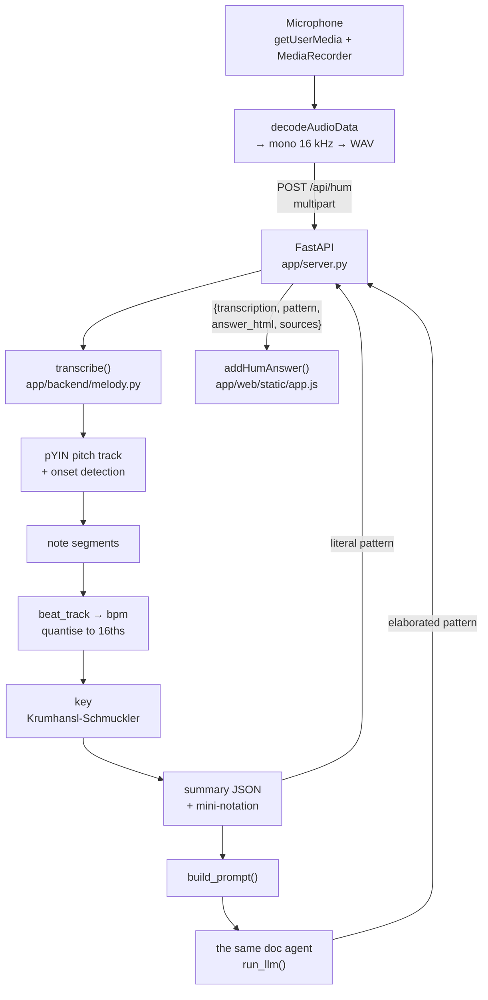

# Humming

Record a melody, get it back as a Strudel pattern. This covers the
transcription pipeline and the decisions inside it.

For the documentation-question path, see [architecture.md](architecture.md).

## The shape of it

Two patterns come back from one request. `pattern` is the literal
transcription, and `answer_html` is the agent's elaboration on top of it.

## The model never hears the audio

This is the load-bearing decision. Language models are unreliable at hearing
pitch and timing, and very good at taking a correct skeleton and making it
musical. So the audio is analysed with signal processing, and what reaches the
agent is a text summary: tempo, key, and a mini-notation string.

The agent's job is then the one it is already good at and already grounded
for. `build_prompt` phrases the request so the existing "code creation or
refinement" branch of the system prompt in `app/backend/core.py` handles it,
and retrieval runs exactly as it does for a typed question. No second agent,
no second system prompt.

## Stage by stage

**Pitch.** `librosa.pyin` gives a per-frame fundamental with a voiced flag.
Each voiced frame is rounded to the nearest semitone and equal runs are
grouped. This needs no onset detector, which matters because a legato hum has
no attack transient to detect.

**Re-articulation.** Pitch runs alone cannot see a repeated note: humming
"c c" is one unbroken run of the same semitone. Humming the same pitch twice
means closing and reopening, so the boundary is a dip in loudness rather than
a change in timbre, and that is what the pipeline looks for: prominent
valleys in the RMS curve.

It was spectral-flux onset detection first, and that failed on realistic
audio. Breath noise dominates the flux, so on a hum with noise and portamento
it found four of six boundaries in one take and misplaced them in another,
collapsing every repeated note. Loudness dips find every boundary in every
take, clean and noisy alike, and the answer does not move across a threefold
range of `DIP_PROMINENCE`.

**Tempo.** The median gap between note starts, octave-folded into 60 to 180
bpm, then snapped to a multiple of 5 when it lands within 1.5% of one.

Two earlier approaches were measured and beaten. Fitting onsets to a grid at a
free tempo is degenerate: the cost is scale-free, so a slower tempo with a
coarser grid fits just as well and the search drifts downwards. `beat_track`
is honest but weak on a voice, which never produces the percussive onset
strength it keys off. The median interval is a direct measurement of the note
rate rather than an inference from it, and it only became available once
loudness dips gave accurate boundaries to measure between.

The median matters, not the mean: a melody that ends on a long note or pauses
for a rest has a few intervals several times the others, and the mean follows
them.

The bounds matter at the edges. An earlier 70 bpm floor turned a melody
genuinely hummed at 70 into 138, because measurement noise put it a hair under
the floor and it was doubled.

**Key.** A duration-weighted pitch-class histogram correlated against the
Krumhansl-Schmuckler profiles over all 24 rotations. Weighting by duration
rather than note count is what stops a long held tonic being outvoted by
passing sixteenths.

**Quantisation.** Onsets and durations in seconds become integer step
positions on a 16th-note grid. Every note claims at least one step, and a note
overlapping its successor is truncated, so the result is a strictly ordered
monophonic line, which is what the mini-notation writer assumes.

### How well it works

There is no ground truth for a recording of a person, so the reference signals
are synthesised from known melodies. Two suites, because a clean tone proves
the pipeline works and only a messy one proves it survives a microphone.

`tests/test_melody.py` uses a vibrato sine with an envelope and slight noise.
`tests/realistic.py` adds portamento, breath noise an order of magnitude
louder, timing jitter, uneven loudness between notes, room rumble, and a
singer drifting flat across the take. Seven melodies from 70 to 150 bpm,
quarters and eighths, three random seeds each on the realistic side.

| | clean | realistic |
| --- | --- | --- |
| Key | 7 of 7 | 21 of 21 |
| Note sequence | 7 of 7 | 20 of 21 |
| Tempo | 7 of 7 within 5% | 21 of 21 within 10% |

The realistic suite is what drove the two design decisions above. Before it,
the same melodies with breath noise lost every repeated note and got the tempo
right in 9 takes out of 21.

Half- and double-time readings remain possible and are survivable: note
lengths are quantised against whatever tempo comes out, so the relative rhythm
is preserved and only the playback speed is wrong. `setcpm` is the first line
of every generated pattern precisely so it is one number to correct.

## Why the browser encodes WAV

`MediaRecorder` produces whatever the engine prefers: WebM/Opus on Chrome, AAC
in an MP4 container on Safari. libsndfile, which
`soundfile` wraps, reads neither. Web Audio decodes all of them, so
`blobToWav` decodes, downmixes and resamples to 16 kHz mono in the browser and
the server only ever sees one format. It also shrinks the upload by an order
of magnitude.

`OfflineAudioContext` does the downmix and the resample in one pass using the
engine's own resampler.

## Two patterns, and why the literal one is always first

`addHumAnswer` renders the literal transcription above the agent's version,
always, even when the model leg failed outright. If the agent's pattern is
wrong or the OpenAI key is dead, the user still gets something that plays back
what they hummed. Recognising your own melody coming back is the entire point
of the feature, and it should not depend on the model behaving.

The same reasoning shapes the prompt. `melody_expression` hands the agent a
finished `note(...).slow(n)` expression to chain onto rather than a rule to
remember, because asked to "add `.slow(2)`" the model simply forgets, and the
melody then plays at double speed.

## Invariants and traps

- **The grid constants are shared.** `STEPS_PER_BEAT`, `BEATS_PER_CYCLE` and
  the `cpm` conversion in `melody.py` all describe one bar of 4/4 per cycle.
  Change one and the generated `setcpm` stops matching the note lengths.
- **`to_pattern` and `build_prompt` must agree.** Both call
  `melody_expression`, so the literal pattern and the one the agent is told to
  use cannot drift apart. Keep it that way.
- **Only the prebaked sounds exist.** `ensureStrudel` loads dirt-samples and
  nothing else, so `piano` and every `gm_*` soundfont name fails at playback
  with "sound not found". `DEFAULT_SOUND` and `AVAILABLE_SOUNDS` in
  `melody.py` encode that, for the literal pattern and for the agent.
